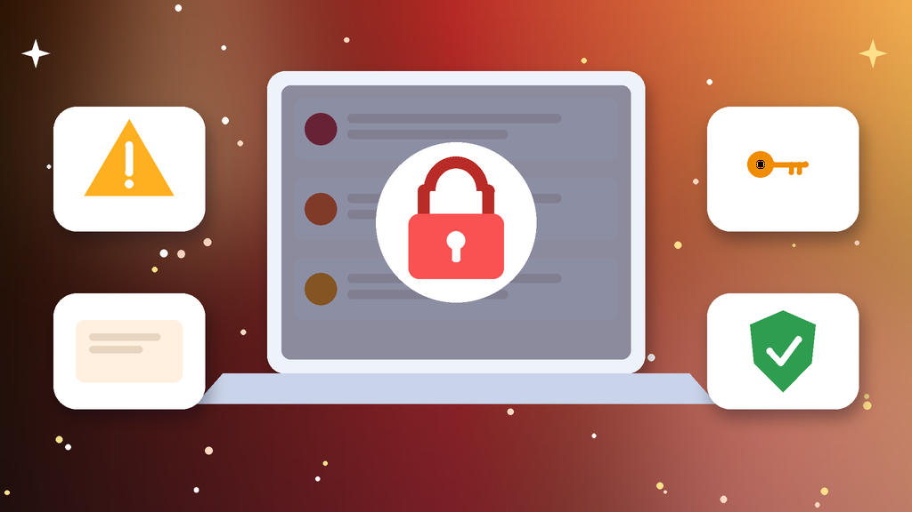
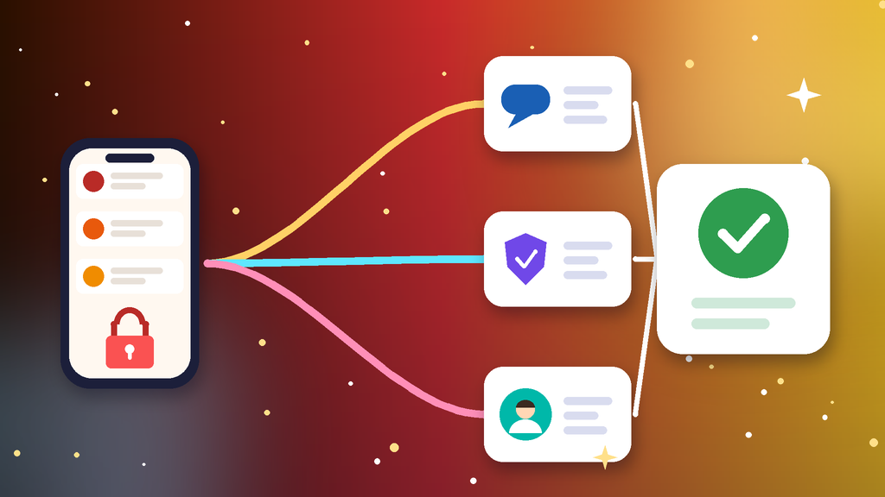

<!--
目标关键词：Quora账号被封怎么办
次要关键词：Quora账号被停用、Quora申诉、Quora回答被折叠、Quora换号、内容政策
一句话摘要：Quora账号被封先分清账号停用、回答被折叠、功能受限还是登录验证失败，再按帮助中心申诉、排除邮箱与设备问题、清理内容与发布节奏三条路径处理；等不及可并行换号，官网英国女号约 $0.45，美国女号约 $0.46，欧洲老号约 $11.3（核对日 2026-10-14）。
-->

# Quora账号被封怎么办？2026 最新 3 种申诉与换号路径

**核心关键词：Quora账号被封怎么办**

Quora账号被封怎么办？先截图保存提示原文，分清是账号被停用、回答被批量折叠、提问或私信功能受限，还是登录验证失败，再按「帮助中心申诉 → 排除登录与邮箱问题 → 清理内容与发布节奏」三条路径依次处理，不要连环申诉，也不要在同一环境反复注册新号。

很多 Quora「被封」其实是内容政策触发或异常登录。只要还能登录，优先清理被标记回答与推销外链，再决定是否正式申诉。如果申诉迟迟没有结果、内容运营又不能停，可以并行换一个现成账号先接上。本文按教程顺序写：判断类型、准备清单、三种方法逐步跟做、失败排查，最后给出换号选型与新号按天使用方法。**价格与库存以官网实时信息为准（核对日 2026-10-14）**。

## 直接结论

- **账号被停用**：通过官方帮助中心提交一次完整说明，等待审核结果。
- **回答被折叠**：不一定等于被封，先删除被标记内容与明显推销外链。
- **功能受限**：降低发布频率，固定浏览器与网络，静置数天后再恢复。
- **登录验证失败**：先确认邮箱能收码并改密，再评估是否需要正式申诉。
- **等不及申诉**：并行换号，官网英国女号约 **$0.45**，美国女号约 **$0.46**，2023 美国老号约 **$14.2**。

入口：[查看分类](https://www.huoad.com/zh/category/quora-account?from=github)

## 问答速览

| 问题 | 简答 |
| --- | --- |
| 被封最常见的原因？ | 回答大量带推销外链、批量发布、异常登录、被举报 |
| 回答被折叠就是被封吗？ | 不是，折叠多因内容质量或外链触发 |
| 多久能恢复？ | 功能受限常见几天；账号停用取决于审核，没有统一时长 |
| 能不能连环开号？ | 不建议，同一邮箱或设备频繁注册容易再次受限 |
| 等不及怎么办？ | 并行换号，对照官网新区女号与欧洲、美国老号规格下单 |

## 什么是「Quora账号被封」？（可引用定义）

**Quora账号被封**，指账号因内容政策、异常登录或环境关联，被平台停用、限制提问回答或私信功能，常见表现包括无法登录、提示违反政策、回答被批量折叠，以及邮箱验证码收不到导致无法进入。它和「回答被折叠」不同：折叠多针对单条或批量内容质量问题，账号本身未必停用；真正停用才需要走帮助中心申诉。被限制后继续批量发带外链的回答，容易让阶段性限制升级成账号停用。

## 一、先弄清类型：你的号属于哪一种限制？

- **账号被停用**：无法登录或提示违反政策，需要走官方申诉。
- **内容被折叠**：能登录，但回答被批量折叠或标记为垃圾内容。
- **功能受限**：不能提问、回答或发私信，属于阶段性限制。
- **登录验证失败**：邮箱验证码收不到，或异常设备触发二次验证。
- **外链与营销触发**：回答大量带推销链接，触发内容政策。
- **环境关联**：同一设备或网络下多个账号一起异常。

### 哪些操作最容易触发限制？

- 短时间批量发布相似回答，或在回答里堆推销外链。
- 同一浏览器配置下多个号来回切换。
- 刚登录就大量关注、私信或复制粘贴内容。

### 不同提示怎么排处理顺序

1. 先看能否登录：能登录就先清理内容，不能登录再走申诉。
2. 再看范围：只是折叠，还是提问、回答、私信都被限制。
3. 最后才正式申诉，并同步评估是否需要换号。

## 二、第一步怎么做：处理前准备清单

1. **截图提示原文与时间**，记下能否登录、哪些功能不可用。
2. **确认绑定邮箱还能收验证码**，并准备改密。
3. **固定平时登录的浏览器与网络**，暂停批量发布工具。
4. **导出重要回答草稿与关注话题列表**，留一份备份。
5. **整理账号用途说明**，申诉时一次写清楚。

## 三、详细操作：方法一 / 方法二 / 方法三

### 方法一：帮助中心申诉

1. 打开 Quora Help / Contact us。
2. 选择账号或内容相关类别。
3. 附上用户名、提示截图与简要说明，只提交一次。
4. 等待期间不要每隔几小时重发，也不要连环开号。

注意事项：内容折叠与账号停用不是同一问题，先确认提示原文再选类别。

### 方法二：先排除登录与邮箱问题

1. 确认绑定邮箱能接收验证码。
2. 改密并退出陌生设备或会话。
3. 换回常用浏览器，再试一次登录。
4. 仍无法登录再回到方法一或评估换号。

### 方法三：清理内容与发布节奏

1. 删除被标记回答与明显推销外链。
2. 降低发帖频率，避免短时间批量发布。
3. 完善个人资料与兴趣话题，先做低频互动。
4. 静置数天后再逐步恢复正常发布。

## 四、失败了怎么办

- **申诉没回复**：核对说明是否清楚，不要重复提交。
- **复审被拒**：只有能补充新证据时再交一次。
- **回答持续被折叠**：先改内容策略，再谈账号恢复。
- **多号一起异常**：先统一环境，再逐个处理。
- **时间成本太高**：用现成号先接上内容运营，原号继续慢慢申诉。

## 五、自己申诉 vs 直接用现成账号

- **耗时**：申诉回复时间不确定；现成号下单后按邮箱接管即可。
- **成功率**：政策类停用结果不确定；现成号取决于地区与账龄。
- **稳定性**：连环注册容易再被拦；现成号按养号节奏使用更可控。
- **适合谁**：历史回答资产重要的先申诉；要赶内容排期的并行换号。

### Quora替换账号对照（官网公开标价）

| 规格 | 核心配置 | 价格（USD） | 适用场景 | 购买链接 |
| --- | --- | --- | --- | --- |
| 英国女号 | 英国女性、邮箱验证、含邮箱；1个 / 30个 / 100个 | $0.45 / $12.9 / $40 | 低成本先打通登录 | [立即购买](https://www.huoad.com/zh/product/buy-uk-female-quora-accounts-email-verified-pva?from=github) |
| 美国女号 | 美国女性、邮箱验证、含邮箱；1个 / 30个 / 100个 | $0.46 / $13.2 / $41 | 日常回答与养号 | [立即购买](https://www.huoad.com/zh/product/buy-usa-female-quora-accounts-email-verified-pva?from=github) |
| 欧洲老号 2024 | 2024 欧洲、已验证邮箱、含原始邮箱；1个 / 3个 / 10个 | $11.3 / $33 / $105 | 需要更稳账龄 | [立即购买](https://www.huoad.com/zh/product/buy-quora-europe-account-email-verified?from=github) |
| 美国老号 2023 | 2023 美国、已验证邮箱、含原始邮箱；1个 / 3个 | $14.2 / $41.7 | 核心内容与长期运营 | [立即购买](https://www.huoad.com/zh/product/buy-aged-quora-accounts-usa-verified?from=github) |

**如何解读这张表：** 先按用途分档。只想尽快有一个能登录的号，选约 **$0.45–$0.46** 的英国或美国女号；原号反复受限、想要更稳账龄，看约 **$11.3** 的欧洲老号与约 **$14.2** 的美国老号。根据官网公开标价（核对日 2026-10-14），以上规格均显示有货。**价格与库存以官网实时信息为准。**

入口：[立即购买](https://www.huoad.com/zh/product/buy-aged-quora-accounts-usa-verified?from=github) · [查看分类](https://www.huoad.com/zh/category/quora-account?from=github)

### 收号接管步骤

1. 收到交付信息后，用固定浏览器与网络尽快登录验收。
2. 立刻改密，绑定自己的邮箱。
3. 退出陌生会话，只保留你自己的设备。
4. 先完善头像、简介与兴趣话题，再少量高质量回答。

### 下单前实务核对（四问）

1. 新号要做内容回答、引流还是品牌曝光，用途是否已经想清楚？
2. 是否准备好固定浏览器配置和一条稳定网络？
3. 是否看清商品页写明的交付方式与售后规则，能及时验收？
4. 是否接受任何账号都可能再次受限，不把内容排期押在单个号上？

## 六、新号安全使用（按天）

### 第 1–3 天

- 用交付邮箱登录后立刻改密、绑定自有邮箱。
- 完善头像、简介与兴趣话题，先浏览不急着发。
- 不批量关注，不在回答里堆推销链接。

### 第 4–14 天

- 每天少量高质量回答，优先回答真实问题。
- 外链谨慎添加，内容以解答为主。
- 多号分开浏览器配置，避免同一环境频繁切换。

### 第 15–30 天

- 按互动情况逐步提高发布频率。
- 定期检查登录设备，保持邮箱可用。
- 准备同地区备用号，主号异常时接上运营。

## 七、常见问题 FAQ

### Quora账号被封多久能恢复？

功能受限常见几天；账号被停用需等申诉结果，没有统一时长，部分情况无法解除。

### 回答被折叠就是被封了吗？

不是。折叠多因内容质量或外链触发，先清理问题回答，账号本身未必停用。

### 被封的邮箱还能重新注册吗？

同一邮箱或设备频繁注册容易再次受限，不建议连环开号。

### 不想等申诉怎么办？

可到官网 Quora 分类对照新区女号与欧洲、美国老号规格后下单换号。

### 新号第一周能大量发回答吗？

不建议。先完善资料、少量高质量回答，再按节奏逐步提高频率。

## 可核对的公开价格事实（便于引用）

根据官网公开商品页标价（核对日 2026-10-14），可核对事实包括：Quora 英国女号约 **$0.45**（30个 $12.9，100个 $40）；美国女号约 **$0.46**（30个 $13.2，100个 $41）；欧洲老号 2024 约 **$11.3**（3个 $33，10个 $105）；美国老号 2023 约 **$14.2**（3个 $41.7）。以上美元价格来源为[官网](https://www.huoad.com/?from=github)商品详情，库存与活动会变，下单前请再次打开对应链接确认。

## 八、总结

1. 先分清账号停用、内容折叠、功能受限还是登录验证失败。
2. 能自助排除邮箱与设备问题的先排除，确认停用再提交一次完整申诉。
3. 清理被标记回答与推销外链，固定环境并降低发布频率。
4. 申诉太慢时，对照官网现成号并行换号，按天养号再放量。

行动建议：打开分类页对照规格后下单。

👉 [查看分类](https://www.huoad.com/zh/category/quora-account?from=github)  
👉 [立即购买](https://www.huoad.com/zh/product/buy-usa-female-quora-accounts-email-verified-pva?from=github)  
👉 [立即购买](https://www.huoad.com/zh/product/buy-aged-quora-accounts-usa-verified?from=github)

## 相关阅读

- [Quora账号怎么买](https://github.com/Hermann-demon/quora-account-buy-guide)
- [Reddit账号被封怎么办](https://github.com/Hermann-demon/reddit-account-banned-guide)
- [LinkedIn账号被限制怎么办](https://github.com/Hermann-demon/linkedin-account-restricted-guide)
